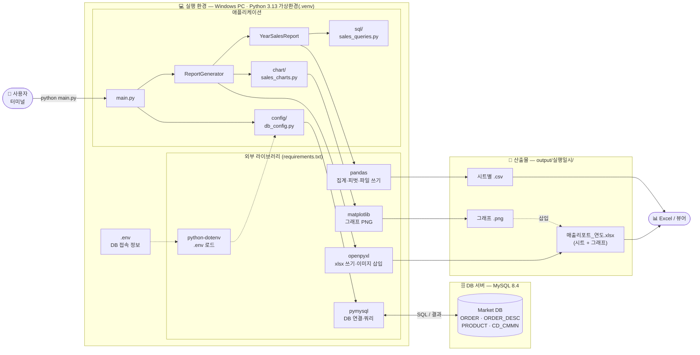
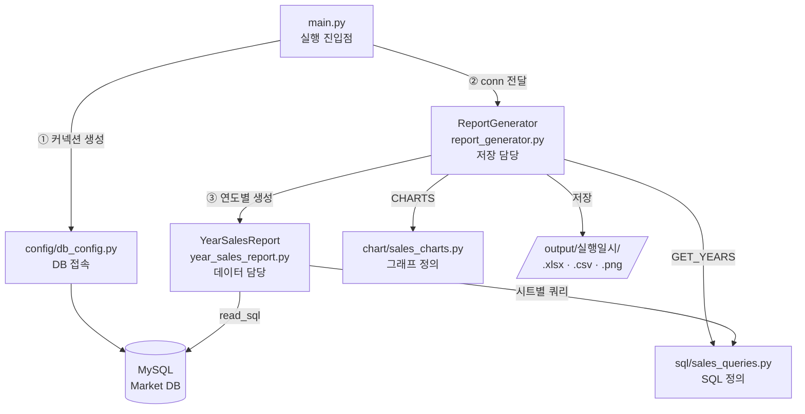
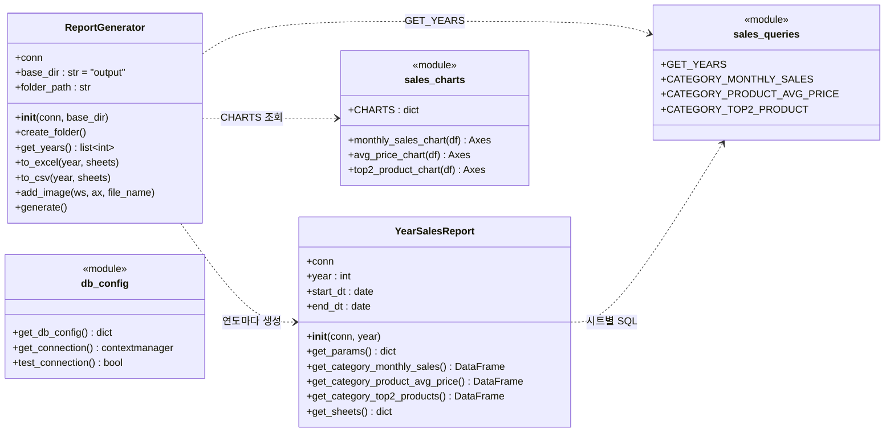
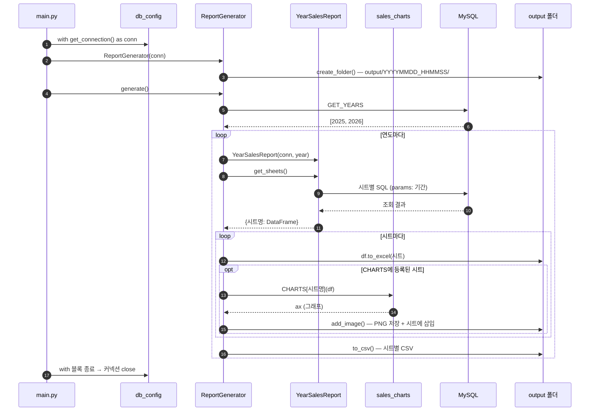
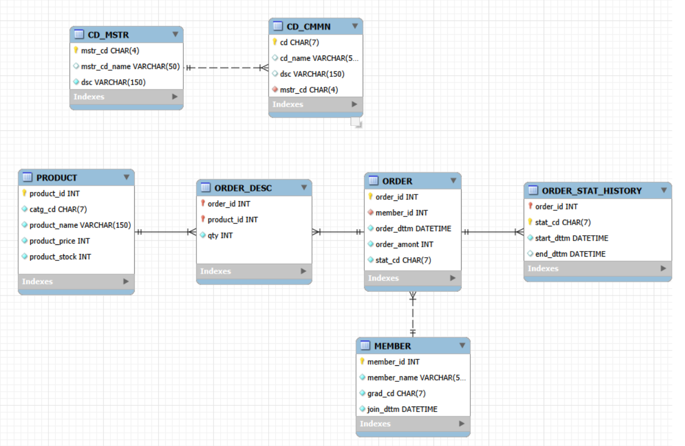
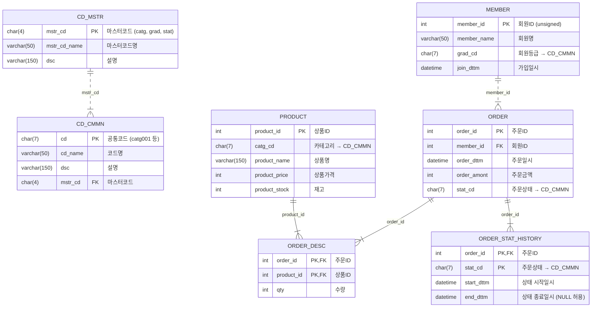
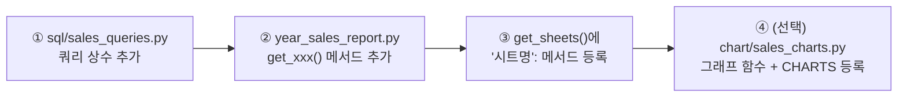

# 📐 매출 리포트 자동 생성기 — 설계서

> 현재 구현된 소스 기준으로 작성한 설계서입니다. (작성일: 2026-11-18)
> 실행 방법·환경 설정은 [ReadMe.md](../ReadMe.md)를 참고하세요.
>
> 이 문서의 도식은 **Mermaid**로 작성되어 있습니다. GitHub에서는 바로 그림으로 보이고,
> VS Code 미리보기에서는 `Markdown Preview Mermaid Support` 확장을 설치하면 보입니다.

---

## 1. 개요

| 항목 | 내용 |
|---|---|
| 목적 | Market DB의 주문·상품 데이터를 연도별로 집계해 Excel(그래프 포함) / CSV 리포트로 자동 생성 |
| 실행 | `python main.py` (프로젝트 루트에서) |
| 입력 | MySQL `ORDER`, `ORDER_DESC`, `PRODUCT`, `CD_CMMN` 테이블 |
| 출력 | `output/실행일시/` 폴더에 연도별 `.xlsx` 1개 + 시트별 `.csv` + 그래프 `.png` |
| 단위 | 주문이 존재하는 **모든 연도**에 대해 연도마다 리포트 1벌 생성 |

---

## 2. 전체 구조

### 2.1 전체 시스템 구조도

실행 환경(PC) · 애플리케이션 · 외부 라이브러리 · DB 서버 · 산출물의 관계입니다.



| 영역 | 구성 | 역할 |
|---|---|---|
| 실행 환경 | Windows PC, Python 3.13 `.venv` | 애플리케이션 실행. 접속 정보는 `.env`(Git 제외)로 분리 |
| 애플리케이션 | `main.py`, 클래스 2개, 정의 모듈 3개 | 조회 → 가공 → 저장 흐름 (2.3, 4장 참고) |
| 외부 라이브러리 | pymysql, pandas, matplotlib, openpyxl, python-dotenv | DB 통신, 데이터 가공, 그래프, Excel 파일 생성 |
| DB 서버 | MySQL 8.4 `Market` 스키마 | 주문·상품·공통코드 원천 데이터 (6장 참고) |
| 산출물 | `.xlsx`, `.csv`, `.png` | 실행할 때마다 `output/YYYYMMDD_HHMMSS/`에 생성 (7장 참고) |

### 2.2 디렉토리 구조와 역할

```text
skp_db_pjt_sales_report/
├── main.py                  # [실행]   DB 연결을 열고 ReportGenerator 실행
├── report_generator.py      # [흐름]   연도 목록 조회 → 연도별 반복 → Excel/CSV/그래프 저장
├── year_sales_report.py     # [데이터] 한 연도의 시트 데이터(DataFrame) 생성
│
├── config/
│   └── db_config.py         # [설정]   .env 로드, DB 커넥션 생성
├── sql/
│   └── sales_queries.py     # [정의]   SQL 쿼리 모음
├── chart/
│   └── sales_charts.py      # [정의]   시트별 그래프 함수 모음
│
├── output/                  # 생성된 리포트 (Git 제외)
└── docs/
    └── 설계서.md             # 이 문서
```

**배치 규칙**
- **root**: 실행 흐름을 담당하는 파일 (연결 → 조회 → 가공 → 저장)
- **폴더**: 흐름에서 가져다 쓰는 설정·정의 모음 (`config/`, `sql/`, `chart/`)

### 2.3 애플리케이션 계층 구조



### 2.4 모듈 간 의존 관계 (import 기준)

```text
main.py
 ├─ config.db_config        → get_connection
 └─ report_generator        → ReportGenerator
     ├─ sql.sales_queries   → GET_YEARS
     ├─ year_sales_report   → YearSalesReport
     │   └─ sql.sales_queries → CATEGORY_MONTHLY_SALES, CATEGORY_PRODUCT_AVG_PRICE, CATEGORY_TOP2_PRODUCT
     ├─ chart.sales_charts  → CHARTS, plt
     └─ openpyxl            → Image, get_column_letter
```

의존 방향은 항상 **위 → 아래** 한 방향이며, 아래 모듈은 위 모듈을 알지 못합니다.

---

## 3. 클래스 설계

### 3.1 클래스 다이어그램



### 3.2 ReportGenerator — 저장 담당

`report_generator.py`. 연도 목록을 구해 연도마다 `YearSalesReport`를 만들고, 받은 시트를 파일로 저장합니다.
**어떤 시트가 있는지는 모르고**, `get_sheets()`가 돌려주는 `{시트명: DataFrame}`을 그대로 저장합니다.

| 메서드 | 역할 |
|---|---|
| `__init__(conn, base_dir="output")` | 커넥션을 받아 두고 출력 폴더 생성 |
| `create_folder()` | `output/YYYYMMDD_HHMMSS/` 폴더 생성 → `self.folder_path` |
| `get_years()` | `GET_YEARS` 실행 → 주문이 있는 연도 목록 `[2025, 2026, …]` |
| `to_excel(year, sheets)` | 시트별로 Excel에 쓰고, `CHARTS`에 등록된 시트는 그래프 이미지 삽입 |
| `add_image(ws, ax, file_name)` | 그래프를 PNG로 저장 → 시트의 표 오른쪽(마지막 열 + 2, 2행)에 삽입 |
| `to_csv(year, sheets)` | 시트마다 CSV 1개 저장 (`utf-8-sig`: Excel에서 한글 정상 표시) |
| `generate()` | 전체 실행: 연도 조회 → 연도별 시트 생성 → Excel/CSV 저장 |

### 3.3 YearSalesReport — 데이터 담당

`year_sales_report.py`. 한 연도의 시트 데이터를 만듭니다.
조회 기간은 `start_dt <= 주문일시 < end_dt` (해당 연도 1/1 ~ 다음 연도 1/1 미만)이며, SQL에 `params`로 바인딩합니다.

| 메서드 | 역할 |
|---|---|
| `__init__(conn, year)` | 연도로 `start_dt`, `end_dt` 계산 |
| `get_params()` | `{"start_date": …, "end_date": …}` — SQL `%(start_date)s` 자리에 바인딩 |
| `get_category_monthly_sales()` | 카테고리 × 1~12월 매출 피벗 + 합계 열/행 |
| `get_category_product_avg_price()` | 카테고리별 상품 수, 평균가 |
| `get_category_top2_products()` | 카테고리별 판매수량 상위 2개 상품 |
| `get_sheets()` | `{시트명: DataFrame}` 반환 — **ReportGenerator와의 연결 지점** |

### 3.4 모듈 (클래스 아님)

| 모듈 | 내용 |
|---|---|
| `config/db_config.py` | `.env`에서 접속 정보를 읽어 `pymysql` 커넥션 생성. `get_connection()`은 `with`로 사용 (블록 종료 시 자동 close) |
| `sql/sales_queries.py` | SQL 문자열 상수 모음 |
| `chart/sales_charts.py` | 그래프 함수 + `CHARTS` 등록표. 한글 폰트(맑은 고딕), 비대화형 백엔드(`Agg`) 설정 |

---

## 4. 처리 흐름

### 4.1 시퀀스 다이어그램



### 4.2 콘솔 출력

```text
==== 2025년도 보고서 생성 시작====
==== 2025년도 보고서 생성 완료====
==== 2026년도 보고서 생성 시작====
==== 2026년도 보고서 생성 완료====
```

---

## 5. 리포트 상세 (시트별)

### 5.1 시트 · 쿼리 · 그래프 매핑

| 시트명 | 생성 메서드 | SQL | 기간 조건 | 그래프 |
|---|---|---|---|---|
| 카테고리별월별매출 | `get_category_monthly_sales()` | `CATEGORY_MONTHLY_SALES` | ✅ | `monthly_sales_chart` — 꺾은선 |
| 카테고리별상품수및평균가 | `get_category_product_avg_price()` | `CATEGORY_PRODUCT_AVG_PRICE` | ❌ (상품 마스터 기준) | `avg_price_chart` — 세로 막대 |
| 카테고리별Top2상품 | `get_category_top2_products()` | `CATEGORY_TOP2_PRODUCT` | ✅ | `top2_product_chart` — 가로 막대 |

### 5.2 카테고리별월별매출

**SQL** — 카테고리 × 월 단위로 `수량 × 상품단가`를 합산합니다.

```text
ORDER ─┬─ ORDER_DESC ── PRODUCT ── CD_CMMN(카테고리명)
       └─ 기간 조건: order_dttm >= start_date AND < end_date
결과 컬럼: 카테고리 | 월(1~12, 정수) | 매출금액
```

> 매출금액을 `ORDER.order_amont`가 아니라 `ORDER_DESC.qty × PRODUCT.product_price`로 계산합니다.
> `ORDER`를 `ORDER_DESC`와 조인한 뒤 `order_amont`를 합치면, 상품이 여러 개인 주문의 금액이 상품 수만큼 중복 합산되기 때문입니다.

**pandas 가공 단계**


**결과 시트 형태**

```text
카테고리   1월  2월  …  12월   합계
가전        0    0  …  …      …
게임        0    0  …  …      …
…
전체 합계   …    …  …  …      …   ← 오른쪽 아래 = 연간 총매출
```

### 5.3 카테고리별상품수및평균가

`PRODUCT`를 카테고리별로 묶어 `상품수`(count distinct), `평균가`(avg, 반올림)를 구합니다.
기간 조건이 없으므로 **모든 연도 파일에 같은 값**이 들어갑니다.

```text
결과 컬럼: 카테고리 | 상품수 | 평균가
```

### 5.4 카테고리별Top2상품

1. 기간 내 주문의 상품별 판매수량 합계 (`sum(qty)`)
2. 카테고리별 판매수량 내림차순 순위 (`row_number() over (partition by catg_cd …)`)
3. 순위 2위까지만 추출

```text
결과 컬럼: 카테고리 | 상품명 | 판매수량 | 순위
```

---

## 6. 데이터베이스

### 6.1 ERD (전체 테이블)

**원본 (MySQL Workbench)**



**Mermaid 버전** — 컬럼·자료형·키는 실제 DB(`SHOW COLUMNS`, `information_schema`) 기준입니다.



**관계 정리**

| 관계 | 종류 | 설명 |
|---|---|---|
| `CD_MSTR` 1 : N `CD_CMMN` | FK (비식별) | 마스터코드 하나에 공통코드 여러 개 |
| `MEMBER` 1 : N `ORDER` | FK (비식별) | 회원 한 명이 주문 여러 건 |
| `ORDER` 1 : N `ORDER_DESC` | FK (식별) | 주문 한 건에 상품 여러 개 — PK 일부 |
| `PRODUCT` 1 : N `ORDER_DESC` | FK (식별) | 상품 하나가 여러 주문에 포함 — PK 일부 |
| `ORDER` 1 : N `ORDER_STAT_HISTORY` | FK (식별) | 주문 한 건의 상태 변경 이력 |
| `CD_CMMN` → `PRODUCT.catg_cd`, `ORDER.stat_cd`, `ORDER_STAT_HISTORY.stat_cd`, `MEMBER.grad_cd` | 논리 참조 (FK 없음) | 코드값만 저장하고, 이름은 `CD_CMMN`과 조인해서 조회 |

### 6.2 리포트에서 사용하는 테이블

| 테이블 | 사용 | 사용 위치 |
|---|---|---|
| `ORDER` | ✅ | 연도 목록(`GET_YEARS`), 기간 조건(`order_dttm`) |
| `ORDER_DESC` | ✅ | 수량(`qty`) — 매출금액·판매수량 계산 |
| `PRODUCT` | ✅ | 단가(`product_price`), 카테고리(`catg_cd`), 상품명 |
| `CD_CMMN` | ✅ | 카테고리 코드 → 이름 |
| `CD_MSTR` | — | (코드 그룹 관리용, 리포트에서는 미사용) |
| `MEMBER` | — | 미사용 (회원·등급별 리포트 추가 시 활용) |
| `ORDER_STAT_HISTORY` | — | 미사용 (상태 이력 분석 시 활용) |

### 6.3 공통코드 (CD_MSTR / CD_CMMN)

| 마스터코드 (`mstr_cd`) | 이름 | 공통코드 (`cd` → `cd_name`) | 사용 컬럼 |
|---|---|---|---|
| `catg` | Category | `catg001` 식품 · `catg002` 가전 · `catg003` 의류 · `catg004` 게임 · `catg005` 명품 | `PRODUCT.catg_cd` |
| `stat` | OrderStatus | `stat001` 주문완료 · `stat002` 배송중 · `stat003` 배송완료 · `stat004` 구매확정 | `ORDER.stat_cd`, `ORDER_STAT_HISTORY.stat_cd` |
| `grad` | MemberGrade | `grad001` VIP · `grad002` Gold · `grad003` Silver · `grad004` Bronze | `MEMBER.grad_cd` |

### 6.4 SQL 작성 규칙

| 규칙 | 이유 |
|---|---|
| 테이블명은 대문자 | DB가 대소문자를 구분 |
| `` `ORDER` ``처럼 백틱으로 감쌈 | `ORDER`는 MySQL 예약어 |
| 스키마명(`dt_pjt.`)은 쓰지 않음 | DB 이름은 `.env`의 `DB_NAME`으로 관리 |
| 기간은 `%(start_date)s`, `%(end_date)s` 바인딩 | 문자열 조합 대신 파라미터 바인딩 (SQL 인젝션 방지) |
| `params`를 쓰는 쿼리에서 `%` 문자는 `%%`로 | pymysql이 쿼리 전체를 `query % params`로 치환 (예: `date_format(…, '%%Y')`, `LIKE '%%abc%%'`) |
| 결과 컬럼 별칭은 한글 (`as 카테고리`) | 그대로 Excel 헤더가 됨 · 그래프 함수가 이 이름을 사용 |

---

## 7. 출력 결과

### 7.1 폴더 · 파일 구조

```text
output/
└── 20261118_130824/                              ← 실행할 때마다 새 폴더
    ├── 매출리포트_2025년도.xlsx                    ← 시트 3개 + 그래프
    ├── 매출리포트_2025년도_카테고리별월별매출.csv
    ├── 매출리포트_2025년도_카테고리별상품수및평균가.csv
    ├── 매출리포트_2025년도_카테고리별Top2상품.csv
    ├── 2025_카테고리별월별매출.png                 ← Excel에 삽입된 그래프 원본
    ├── 2025_카테고리별상품수및평균가.png
    ├── 2025_카테고리별Top2상품.png
    └── … (2026년도 동일 구성)
```

### 7.2 Excel 시트 레이아웃

```text
┌───────────────────────────────┬───┬──────────────────────┐
│  A ~ N열: 데이터 표            │   │  그래프 이미지         │
│  (헤더 1행, index 없음)        │빈칸│  (마지막 열 + 2, 2행)  │
└───────────────────────────────┴───┴──────────────────────┘
```

그래프 위치는 `get_column_letter(ws.max_column + 2) + "2"`로 표 너비에 맞춰 자동 계산됩니다.

---

## 8. 확장 가이드

`ReportGenerator`는 `get_sheets()`의 결과와 `CHARTS`만 보고 동작하므로, 아래 작업 모두 **`report_generator.py` 수정 없이** 가능합니다.

### 8.1 시트 추가



### 8.2 작업별 수정 위치

| 하고 싶은 것 | 수정할 파일 |
|---|---|
| 새 시트(데이터) 추가 | `sql/sales_queries.py` + `year_sales_report.py` |
| 그래프 추가 | `chart/sales_charts.py` — 함수 작성 + `CHARTS`에 한 줄 |
| 그래프 모양 변경 | `chart/sales_charts.py`의 해당 함수 |
| 그래프 빼기 | `CHARTS`에서 해당 줄 삭제/주석 |
| 집계 기준 변경 | `sql/sales_queries.py` |
| 다른 기간 단위 리포트 (예: 분기) | `get_sheets()`를 가진 새 클래스 작성 → `generate()`에서 사용 |

### 8.3 지켜야 할 약속

- `CHARTS`의 키는 `get_sheets()`의 **시트명과 정확히 같아야** 합니다. 다르면 오류 없이 그래프만 빠집니다.
- 그래프 함수는 **컬럼명(SQL 별칭)에 의존**합니다. 별칭을 바꾸면 그래프 함수도 함께 수정합니다.
- 그래프 함수는 `DataFrame`을 받아 `ax`(matplotlib Axes)를 반환합니다. 저장·닫기(`plt.close`)는 `ReportGenerator.add_image()`가 처리합니다.

---

## 9. 제약 사항 및 개선 후보

| 구분 | 내용 | 영향 / 개선 방향 |
|---|---|---|
| 매출 단가 | `ORDER_DESC`에 주문 당시 단가가 없어 **현재** `PRODUCT.product_price`로 계산 | 상품 가격이 바뀌면 과거 매출도 바뀜 → `ORDER_DESC`에 주문 단가 컬럼 추가 검토 (현재 데이터는 `order_amont`와 전부 일치 확인) |
| 매출 범위 | 주문상태 4종(주문완료~구매확정)을 모두 매출로 집계 | 매출 기준을 정하면 `stat_cd` 조건 추가 |
| 평균가 시트 | 기간 조건 없음 → 연도별 파일에 같은 값 | "해당 연도 판매 상품 기준"이 필요하면 쿼리에 기간 조건 추가 |
| DB 연결 방식 | `pandas.read_sql`에 pymysql 커넥션 사용 → `UserWarning` 발생 | `main.py`에서 경고 숨김 처리. 필요 시 SQLAlchemy 전환 |
| 그래프 Y축 | 금액이 크면 `1e6` 지수 표기로 표시 | `ax.yaxis.set_major_formatter`로 천 단위 콤마 표기 |
| 출력 폴더 | 실행마다 새 폴더가 쌓임 | 필요 시 오래된 폴더 정리 |
